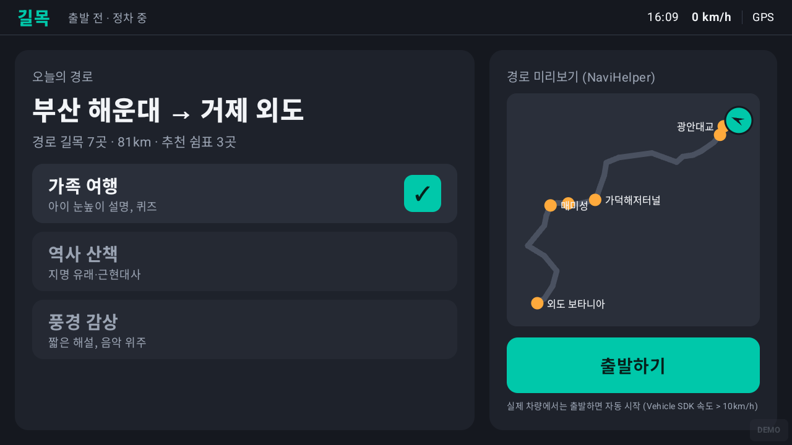
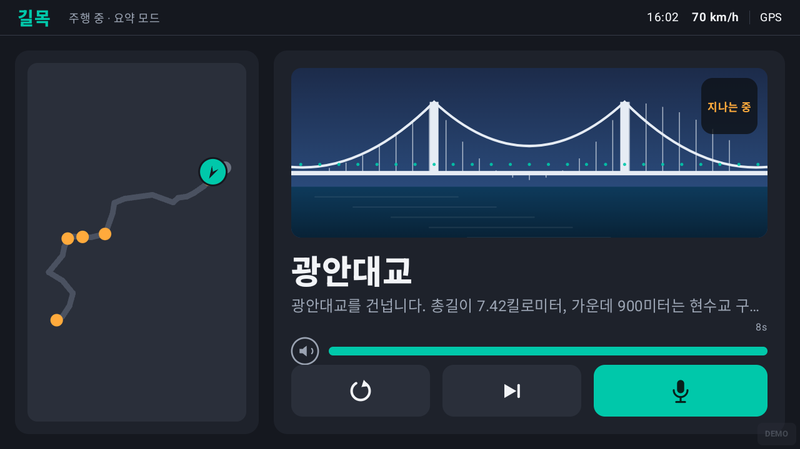
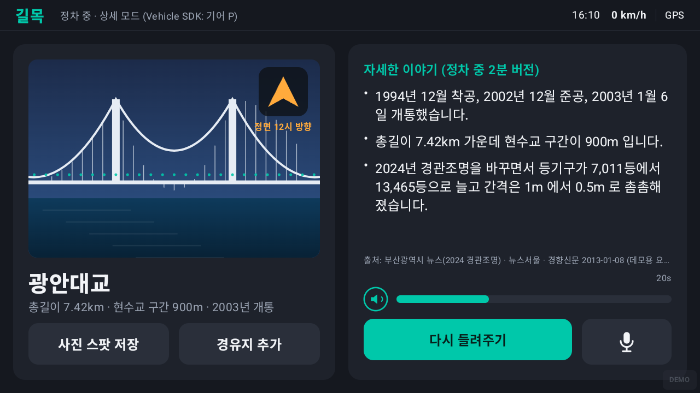
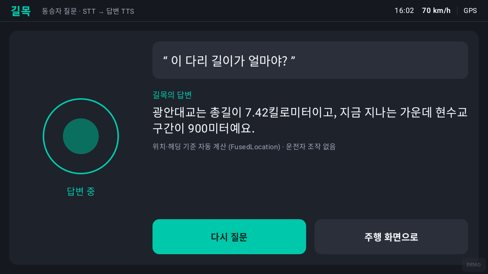
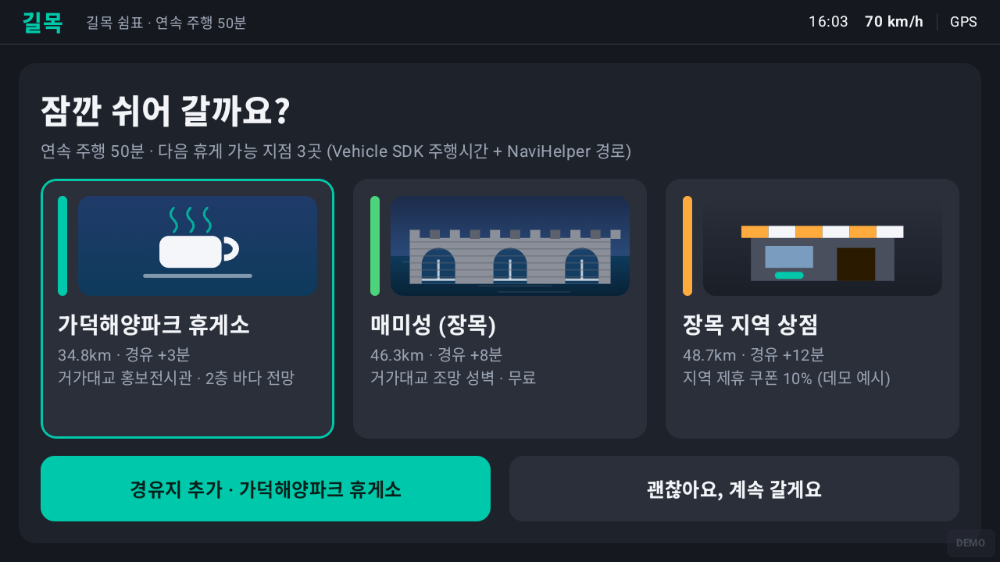
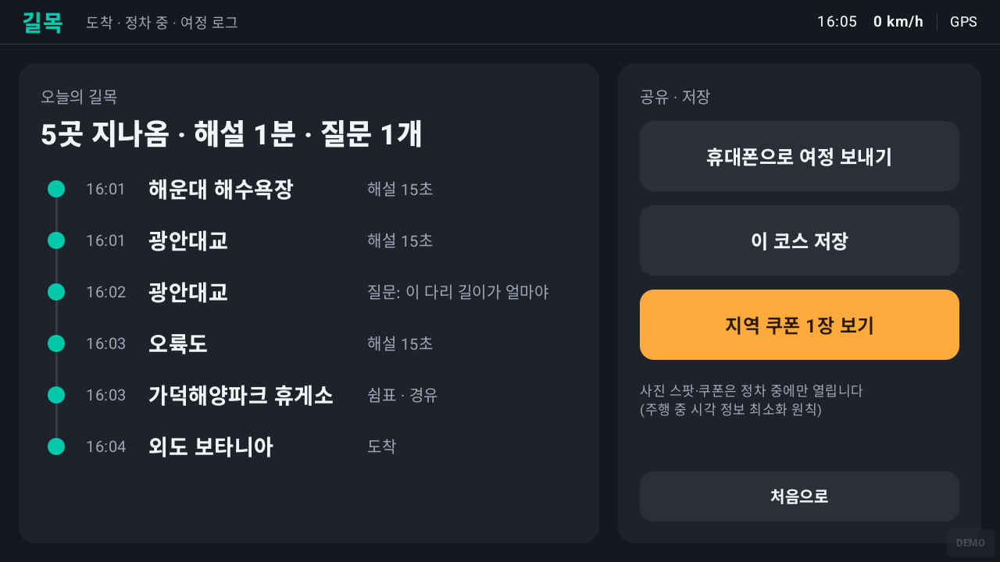

# 길목 (GILMOK)

현대자동차그룹 차량용 앱 개발 공모전 일반 부문 출품작 · 윤진호 (개인 참가)

## 앱 이름 및 한 줄 소개

**길목 (GILMOK)** — 지금 창밖에 보이는 것을, 지금의 주행 상황에 맞는 길이로 들려주는 차량용 AI 도슨트.

주행 중에는 15초 요약, 정차하면 2분 상세로 해설합니다. 동승자가 "저 섬 이름이 뭐야?" 라고 물으면 차량의 위치와 진행 방향을 기준으로 답합니다.

| | |
|---|---|
| 플랫폼 | Pleos Connect (Android 기반 인포테인먼트) 대상 · Android minSdk 28 / targetSdk 35 |
| 언어·UI | Kotlin 2.1 · Jetpack Compose (Material 3) · Gradle 8.12 / AGP 8.7.2 |
| 화면 | 가로 1280×720 차량 디스플레이 기준, 다크 테마, 터치 타깃 48dp 이상 |
| 상태 | **프로토타입 (시뮬레이터 모드)** — 차량·내비 신호는 내장 주행 시뮬레이터가 공급, TTS 는 Android 기본 엔진으로 실제 발화 |
| APK | `apk/윤진호_길목_release.apk` (release 빌드, debug keystore 서명) |

## 실행 방법

### 요구 사항
- Android Studio (Ladybug 이상) 또는 Android SDK 35 + JDK 17 이상
- 에뮬레이터: 가로 1280×720, 160dpi 권장 (아래 AVD 설정). 휴대폰 AVD 에서도 가로 모드로 동작

### 1) APK 바로 설치
```bash
adb install -r apk/윤진호_길목_release.apk
adb shell am start -n com.zainoha.gilmok/.MainActivity
```

### 2) 소스 빌드
```bash
# 프로젝트 루트(이 README 가 있는 폴더)에서
# local.properties 에 sdk.dir 지정 (local.properties.example 참고)
./gradlew assembleDebug            # app/build/outputs/apk/debug/윤진호_길목_debug.apk
./gradlew assembleRelease          # app/build/outputs/apk/release/윤진호_길목_release.apk
```
Windows 는 `gradlew.bat`. release 는 `~/.android/debug.keystore` 로 서명하도록 설정돼 있어 별도 키 없이 설치된다 (`app/build.gradle.kts` signingConfigs).

### 3) 차량 디스플레이 비율 AVD 만들기 (선택)
```bash
avdmanager create avd -n gilmok_car -k "system-images;android-35;google_apis_playstore;x86_64" -d pixel
```
생성 후 `~/.android/avd/gilmok_car.avd/config.ini` 에서 `hw.lcd.width=1280`, `hw.lcd.height=720`, `hw.lcd.density=160`, `hw.initialOrientation=landscape` 로 바꾸고 `emulator -avd gilmok_car` 로 실행.

## 테스트 환경 및 필요한 설정
| 항목 | 값 |
|---|---|
| 검증한 환경 | Windows 11 · Android Emulator 35.2.10 (WHPX) · AVD `gilmok_car` (API 35, Google Play 이미지, x86_64, 1280×720/160dpi) |
| JDK | Temurin 21 (빌드), Compose 는 JVM 17 타깃 |
| TTS | 에뮬레이터 기본 Google TTS 로 한국어 발화 확인. 한국어 음성 데이터가 없는 기기에서는 진행 막대 옆에 "TTS 음성 데이터 없음 · 자막만" 표시 후 자막만 진행 |
| 권한 | 시뮬레이터 모드는 권한 불필요. 네트워크·외부 API 키 없음 |
| 데모 조작 | 화면 오른쪽 아래 반투명 `DEMO` 칩(또는 왼쪽 상단 "길목" 로고) → 속도 슬라이더, 정차(기어 P) 토글, 길목 사이 빨리감기 ×60, 다음 길목 점프, 쉼표 제안, 도착 점프, 샘플 음성 질문 6개 |

시연 영상 촬영 순서는 [DEMO_SCRIPT.md](DEMO_SCRIPT.md) 참고.

## APK 파일 위치

- 저장소 내 경로: [`apk/윤진호_길목_release.apk`](apk/윤진호_길목_release.apk) (약 18MB)
- release 빌드이며, 공모전 제출용으로 Android debug keystore 로 서명했습니다.

## 화면

| 01 홈 | 02 주행 중 요약 해설 |
|---|---|
|  |  |
| 경로·테마 선택, NaviHelper 경로 미리보기 | 글자 최소화: 길목 이름 + 한 줄 자막 + 진행 막대. 주황 배지가 창밖 방향 |

| 03 정차 상세 해설 | 04 동승자 음성 질문 |
|---|---|
|  |  |
| 기어 P 감지 시 자동 전환. 상세 3문장 + 출처 | STT → 위치·헤딩 기준 답변 → TTS |

| 05 길목 쉼표 (경유지 제안) | 06 여정 로그 |
|---|---|
|  |  |
| 연속 주행 시간 + 남은 경로로 휴게 지점 3곳, 한 번 터치로 경유지 추가 | 지나온 길목·질문·경유 타임라인, 도착 시 자동 표시 |

## 핵심 기능 3개와 SDK 매핑

| 기능 | 동작 | 쓰는 신호 (인터페이스) | Pleos SDK 대응 |
|---|---|---|---|
| 길목 해설 | 길목 700~900m 앞에서 15초 요약 TTS. 속도 0·기어 P 면 2분 상세로 전환, 다시 달리면 요약 모드 | `VehicleProvider`(속도·기어), `LocationProvider`(위치·헤딩), `TtsProvider` | Vehicle, FusedLocation, TTS |
| 동승자 음성 질문 | "저 섬 이름이 뭐야?" → 현재 위치·진행 방향에서 대상의 상대 방위를 계산해 "왼쪽 10시 방향" 으로 답변 | `SttProvider` → `Geo.relative()` → `TtsProvider` | STT, FusedLocation, TTS |
| 길목 쉼표 | 연속 주행 45분(시뮬레이션 시간) 넘으면 경로 앞쪽 휴게 지점 3곳 제안, 터치 한 번에 경유지 추가 | `VehicleProvider`(연속 주행 시간), `NaviProvider.addWaypoint()` | Vehicle, NaviHelper |

## 프로젝트 구조
```
app/src/main/java/com/zainoha/gilmok/
  MainActivity.kt                 전체 화면 + Compose 진입
  sdk/Providers.kt                VehicleProvider · LocationProvider · NaviProvider · TtsProvider · SttProvider 인터페이스
  sdk/sim/DriveSimulator.kt       해운대 → 거제 외도 경로선을 따라 좌표·속도·기어·연속 주행 시간을 만들어 내는 시뮬레이터
  sdk/sim/SimProviders.kt         시뮬레이터를 각 인터페이스로 감싼 구현 + 샘플 STT
  sdk/sim/AndroidTtsProvider.kt   Android TextToSpeech (실제 발화)
  sdk/pleos/PleosAdapters.kt      Pleos Connect SDK 어댑터 자리 (TODO)
  content/RouteData.kt            경로선 31점, 길목 7곳(요약·상세·질문·출처), 쉼표 지점 4곳, 샘플 질문
  domain/Geo.kt                   거리·방위·상대 방향("왼쪽 10시 방향") 계산
  domain/GilmokViewModel.kt       길목 엔진: 트리거 판정, 주행/정차 모드 전환, 질문 답변, 쉼표 제안, 로그
  ui/theme, ui/components         다크 테마, 큰 버튼, 진행 막대, 방향 배지, 경로 미니맵, Canvas 일러스트
  ui/screens/Screens.kt           홈 · 주행 · 정차 · 질문 · 쉼표 · 로그 6개 화면
  ui/DemoPanel.kt                 숨김 데모 조작 패널
content/sources.md                해설 문장의 출처
apk/                              release APK
screenshots/                      에뮬레이터 캡처
tools/                            시연 영상 녹화·음성 합성 스크립트 (영상 파일은 저장소에 넣지 않음)
```

## 실제 SDK 로 바꾸기 (어댑터 자리)
길목 엔진(`GilmokViewModel`)은 5개 인터페이스만 본다. 시뮬레이터를 떼고 Pleos Connect SDK 를 붙이는 순서:

1. **의존성**: Pleos Playground 가 안내하는 모듈을 `app/build.gradle.kts` 에 추가 (문서 예시: `ai.pleos.playground:FusedLocation:1.0.4`; Vehicle · NaviHelper · TTS/STT 도 같은 방식). 각 SDK 가 요구하는 권한을 `AndroidManifest.xml` 에 선언.
2. **어댑터 구현**: `sdk/pleos/PleosAdapters.kt` 의 TODO 를 채운다. 공통 패턴은 문서(NaviHelper SDK v3.0.5 기준)대로 `객체 생성 → initialize() → addListener()/콜백 등록 → 요청 → 콜백 수신 → removeListener() → release()` 이고, 콜백 값을 `MutableStateFlow` 에 넣기만 하면 된다.
   - `PleosVehicleProvider`: 속도·기어 신호 → `VehicleState`
   - `PleosLocationProvider`: 위도·경도·bearing → `LocationFix`
   - `PleosNaviProvider`: 경로·주행 상태 이벤트 → `RouteState`, 경유지 추가 API → `addWaypoint()`
   - TTS/STT: `AndroidTtsProvider` 와 같은 계약(`speak/stop`, `transcripts`)으로 Pleos 음성 SDK 를 감싼 클래스 작성
3. **교체**: `GilmokViewModel` 상단의 프로바이더 생성 5줄에서 `Sim*Provider` 를 `Pleos*Provider` 로 바꾼다. 엔진·화면 코드는 수정 없음.
4. **콘텐츠**: `RouteData` 의 길목 좌표·문장을 한국관광공사 TourAPI 등 외부 데이터 소스로 대체 (현재 좌표는 데모용 근사값, 출처는 `content/sources.md`).

> Pleos Playground 문서는 2026-10 기준 로그인 없이 개요 페이지만 확인했고, FusedLocation SDK 는 "준비 중" 표기가 있었다. 실제 패키지명·메서드명은 Playground 에서 확인 후 어댑터에 반영한다.

## 제약·알려진 한계
- 경로선과 길목 좌표는 수기 근사값이며 실제 도로 선형과 다르다. 시뮬레이터의 거리·방향 계산 데모용.
- 길목 사이 구간은 데모용 빨리감기(×60)로 넘어간다. 실제 차량에서는 Vehicle/FusedLocation 신호가 시간을 결정하므로 해당 로직(`DriveSimulator.slowZones`)은 제거 대상.
- STT 는 샘플 문장 선택으로 대체했다 (마이크 권한·음성 인식 SDK 미연동).
- 길목 그림은 Compose Canvas 로 그린 플레이스홀더이며 실사진이 아니다.
- 해설 문장은 공개 보도·관광 안내 자료를 요약한 것으로, 출처 간 수치가 다른 항목은 제외했다 (`content/sources.md`).

## 출품작 권리 · 오픈소스 · 출처

- 저작권: © 2026 윤진호. 코드·기획·화면은 참가자가 직접 기획·제작했으며, 공모전 심사 외 용도의 복제·재배포를 허용하지 않습니다. 개발 과정에는 생성형 AI 도구를 활용했습니다.
- 그림·아이콘: 앱 안의 그림과 앱 아이콘은 이 저장소에서 만든 Compose Canvas·벡터 그림입니다. 외부 사진·글꼴·음원은 넣지 않았습니다.
- 해설 문장: 공개 보도와 관광 안내 자료를 요약해 새로 썼고, 출처는 [`content/sources.md`](content/sources.md) 에 적었습니다.
- Pleos Connect SDK: 이 저장소에 포함되어 있지 않습니다 (`sdk/pleos/PleosAdapters.kt` 는 연동 자리).

| 오픈소스 구성 요소 | 라이선스 |
|---|---|
| AndroidX (core-ktx, activity-compose, lifecycle), Jetpack Compose | Apache License 2.0 |
| Kotlin, kotlinx.coroutines | Apache License 2.0 |
| Gradle Wrapper | Apache License 2.0 |
